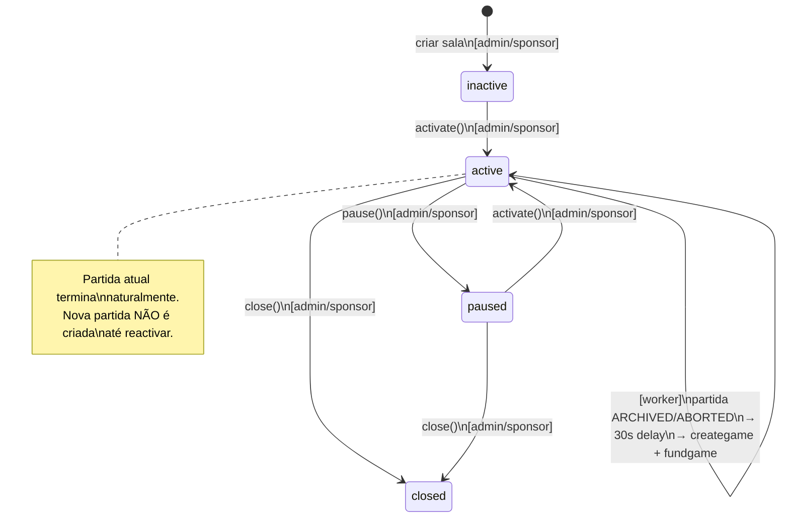

# ADR-010: Salas (Rooms) — Salas Persistentes com Auto-Scheduling e Gestão por Patrocinadores

**Data:** 2026-05-27
**Status:** Aceito
**Autores:** Célula de Engenharia CryptoBingo

---

## Contexto

O sistema atual trata cada partida de bingo como uma entidade isolada (`games`). Não há
conceito de "sala" — um espaço persistente que:
- Mantém uma configuração estável (moeda, faixa de preço de cartelas, game type, peso de prêmio)
- Cria automaticamente novas partidas quando a anterior termina
- Permite que patrocinadores (sponsors) gerenciem suas próprias salas com drops personalizados
- Dá aos jogadores um lobby com informações em tempo real sobre cada sala

Além disso, o chat mencionado na arquitetura (`architecture.md §4.1`, `architecture.md §6.2`)
nunca foi implementado e deve ser associado às salas.

---

## Decisões

### 1. Modelo Híbrido On-Chain + Off-Chain

**On-chain** (tabela `rooms` no contrato `bingo.cpp`):
- `room_id` (uint64, PK)
- `sponsor` (name) — conta patrocinadora (pode ser `_self` para salas do sistema)
- `gametype_id` (uint64) — FK para `gametypes`
- `currency` (extended_asset) — moeda base da sala (ticket_price e prêmios usam esta moeda)
- `ticket_price_min` / `ticket_price_max` (extended_asset) — range permitido
- `ticket_price_default` (extended_asset) — valor sugerido
- `weight` (uint64) — multiplicador de prêmio (padrão 1.00, escalado por 100)
- `max_tickets_per_player` (uint32) — limite por jogador por partida
- `current_game_id` (uint64) — partida ativa no momento
- `nft_template_allowlist` (vector<int32_t>) — templates de NFT que permitem acesso à sala
- `sponsor_room` (bool) — se `true`, a sala é gerida por sponsor
- `room_drop_chance_bps` (uint16) — pré-check global de drop por partida (0–10000, default 10000 = sempre testa drops). Ver ADR-011 §7 Fase 0.
- `status` (name) — `inactive`, `active`, `paused`, `closed`
- `created_at` / `paused_at` (time_point_sec)

**Off-chain** (MongoDB — coleção `rooms_metadata`):
- `room_id` (referência à tabela on-chain)
- `name` / `description` — metadados visuais
- `drops` — array de configs de drops (mantido por compatibilidade; fonte de verdade é on-chain via `drop_allocations`):
  - `token_contract` + `symbol` + `amount` (para tokens fungíveis)
  - `template_id` + `collection_name` (para NFTs AtomicAssets)
  - `drop_chance_pct` (probabilidade por partida)
  - `max_drops_per_game` — máximo de drops distribuídos por partida
- `has_active_drops` (bool, computed) — `true` se há pelo menos 1 `drop_allocation` ativa para esta sala; atualizado pelo dropWorker após cada execução. Usado pelo Lobby para exibir badges sem consultar `drop_allocations` a cada render.
- `room_drop_chance_bps` (uint16, cópia do on-chain) — configurável pelo sponsor no painel; sincronizado ao salvar a sala.
- `chat_enabled` (bool)
- `auto_start_delay_sec` (uint32, default 30) — delay entre fim de uma partida e início da próxima
- `cover_image_url` (string)
- `rules_summary` (string) — texto livre visível no lobby

### 2. FSM da Sala



### 3. Auto-Criação de Partidas (Worker)

O worker `game-loop` ganha um novo consumidor:

1. Escuta o evento `game_resolved` (uma partida transitou para `ARCHIVED` ou `ABORTED`)
2. Verifica se o `game_id` pertence a alguma sala (`rooms.current_game_id == game_id`)
3. Se a sala estiver `active`:
   a. Aguarda `auto_start_delay_sec` (padrão 30s)
   b. Gera um novo `game_id` (auto-incremento)
   c. Chama `creategame()` com o `gametype_id`, `ticket_price_default` e moeda da sala
   d. Chama `fundgame()` para abrir vendas
   e. Atualiza `rooms.current_game_id` para o novo game_id
4. Se a sala estiver `paused` ou `closed`, não faz nada

### 4. Preço de Cartela por Range

- Cada sala define `ticket_price_min` e `ticket_price_max`
- O jogador escolhe o valor unitário da cartela dentro deste range
- Um lote de N cartelas tem o mesmo preço unitário (N * preço = total)
- O frontend exibe o total antes da confirmação
- O contrato valida que `ticket_price` está dentro do range da sala (se game pertence a uma sala)

### 5. Weight por Sala

Cada sala tem um `weight` (uint64, default 100 = 1.00x) que multiplica o prêmio calculado.
O cálculo no `claimwin()` passa a ser:

```
payout = ticket_price * base_multiplier * win_weight * room_weight / 100
```

Isso permite salas com pagamentos diferenciados (ex: sala VIP com weight 2.0x).

### 6. Drop Vault — Rastreamento On-Chain de Ativos para Drops

#### 6.1. Princípios Gerais

Diferente do modelo off-chain descrito inicialmente, o sistema de drops exige **rastreabilidade
on-chain** da origem de cada ativo. Isso é necessário porque:

- Sponsors/enviam tokens e NFTs para a conta do contrato para serem distribuídos como drops
- O remetente original (owner) precisa poder reivindicar seus ativos **não distribuídos** de volta
- Um mesmo ativo alocado a uma sala não pode estar disponível para outra sala simultaneamente
- O contrato precisa saber, de forma trustless, quem depositou o quê, em qual quantidade,
  e quanto ainda resta disponível

#### 6.2. Conta Custodiante (Vault)

Todos os ativos destinados a drops residem em uma **conta custodiante dedicada**.
Duas opções:

- **Opção A (simples):** A própria conta do contrato (`bingo.game`) atua como custodiante.
  Os depósitos caem no `on_notify` de `eosio.token` e `atomicassets`.
- **Opção B (segregação):** Uma conta separada `bingo.vault` (ou `bingo.drop`)
  é criada exclusivamente para custodiar ativos de drops. O contrato `bingo.game`
  tem permissão para transferi-los dali para jogadores.

**Decisão:** Opção A (simples) para v1. A segregação pode ser implementada futuramente
sem quebrar compatibilidade, bastando criar a nova conta e transferir os saldos.

#### 6.3. Nova Tabela On-Chain: `drop_deposits`

**Scope:** `_self` (global). **Primary Key:** `deposit_id` (auto-incremento).
**Secondary Index:** `by_owner`.

| Campo | Tipo | Descrição |
|---|---|---|
| `deposit_id` | `uint64` | ID único do depósito |
| `owner` | `name` | Quem depositou o ativo (sponsor/admin) |
| `asset_type` | `name` | `"token"_n` ou `"nft"_n` |
| `token_contract` | `name` | Contrato do token (ex: `eosio.token`) |
| `token_symbol` | `symbol` | Símbolo do token (ex: `4,BINGO`) |
| `quantity_original` | `asset` | Quantidade original depositada (token) |
| `quantity_remaining` | `asset` | Saldo ainda não alocado a nenhuma sala |
| `nft_asset_id` | `int32` | Asset ID do NFT (0 = token) |
| `nft_template_id` | `int32` | Template ID do NFT |
| `nft_collection` | `name` | Coleção do NFT |
| `status` | `name` | `"available"_n`, `"depleted"_n` |
| `deposited_at` | `time_point_sec` | Timestamp do depósito |

#### 6.4. Nova Tabela On-Chain: `drop_allocations`

Registra a alocação de ativos a salas específicas.

**Scope:** `_self` (global). **Primary Key:** `alloc_id` (auto-incremento).
**Secondary Index:** `by_room`.

| Campo | Tipo | Descrição |
|---|---|---|
| `alloc_id` | `uint64` | ID único da alocação |
| `deposit_id` | `uint64` | FK → `drop_deposits.deposit_id` |
| `room_id` | `uint64` | Sala destino |
| `quantity_allocated` | `asset` | Quantidade alocada (token) |
| `quantity_distributed` | `asset` | Quantidade já distribuída (token) |
| `nft_asset_id` | `int32` | Asset ID do NFT alocado (0 = token) |
| `nft_template_id` | `int32` | Template ID do NFT |
| `drop_chance_pct` | `uint8` | Probabilidade por partida (0-100) |
| `max_drops_per_game` | `uint32` | Máximo de drops por partida |
| `drops_executed` | `uint32` | Contador de drops já realizados |
| `status` | `name` | `"active"_n`, `"exhausted"_n` |

#### 6.5. Fluxo de Depósito

1. Sponsor envia tokens para `bingo.game` com memo `"drop:{room_id}:{chance_pct}:{max_per_game}"`
   (ex: `"drop:1:10:5"` = sala 1, 10% de chance, max 5 drops por partida)
2. O `on_notify` reconhece o prefixo `"drop:"` e:
   a. Cria registro em `drop_deposits`
   b. Se `room_id` presente, cria registro em `drop_allocations`
3. Para NFTs: o sponsor faz `transfer` do NFT para `bingo.game` com o mesmo formato de memo

#### 6.6. Fluxo de Reivindicação (Refund)

1. O owner original consulta seus ativos não alocados (`drop_deposits` com `status == available`)
2. Chama `reclaimasset(owner, deposit_id)` — o contrato devolve o saldo ao owner
3. **Importante:** só pode reivindicar ativos com `status == available` (não alocados).
   Ativos alocados mas não distribuídos não podem ser reivindicados — evitando quebrar
   a promessa de drops configurada na sala.

#### 6.7. Fluxo de Distribuição (Drop Execution)

1. Worker de drops é disparado ao final de cada partida (`ARCHIVED`)
2. Para cada sala com drops configurados:
   a. Varre `drop_allocations` filtrando por `room_id` e `status == active`
   b. Para cada alocação, sorteia se haverá drop (baseado em `drop_chance_pct`)
   c. Se sorteado, seleciona aleatoriamente um jogador que comprou cartelas na partida
   d. Executa a distribuição via `execdrop(alloc_id, winner, quantity, nft_asset_id)`:
      - **Token:** `bingo.game` faz `transfer` para o jogador
      - **NFT:** `bingo.game` faz `transfer` do AtomicAssets para o jogador
   e. Atualiza `drops_executed++` e `quantity_distributed`; se esgotou, marca `status = exhausted`
   f. Emite evento WebSocket `chat:sponsor_drop` para o chat da sala

#### 6.8. Configuração Off-Chain vs On-Chain

A **configuração de quais salas têm drops ativos** pode ser off-chain (MongoDB).
O **saldo disponível e a alocação** são on-chain para garantir trustless accounting.

- MongoDB: mapeamento `room_id → [configs de drop]` para o frontend e worker
- On-chain: `drop_deposits` + `drop_allocations` + `dropstate` singleton para saldos e execução

#### 6.9. Compatibilidade com Campanhas B2B

As campanhas B2B (ADR-008, tabela `campaigns`) continuam existindo como sistema
global de patrocínio de prêmios. Drops por sala são complementares:

- **Campanhas B2B:** injetam tokens no `sponsor_pool` do jogo, pagos ao vencedor
  junto com o prêmio principal via `claimwin()`
- **Drops:** distribuição aleatória a **qualquer jogador** da sala (não apenas
  ao vencedor), independente do resultado da partida

### 7. Chat por Sala (WebSocket)

O chat é implementado como extensão do `broadcaster.ts` (Socket.io):
- Cada sala é um room Socket.io: `room:{room_id}`
- Mensagens persistidas no MongoDB (`chat_messages`) com TTL de 7 dias
- Eventos:
  - `chat:send` — cliente envia mensagem
  - `chat:message` — servidor broadcasta para a sala
  - `chat:sponsor_drop` — broadcast especial com animação de drop
- Sponsor drops no chat: quando um drop acontece, uma mensagem especial é broadcastada
- Rate limiting por jogador (máx 1 msg/seg)

### 8. Telas de Admin/Sponsor

**Admin** (seção "Salas" no AdminLayout):
- Listar salas (on-chain + metadados)
- Criar sala (nome, gametype, moeda, sponsor opcional, ticket_price range, weight, max_tickets)
- Editar metadados (drops, descrição, cover image, delay)
- Pausar/Reativar/Fechar sala

**Sponsor** (seção "Minhas Salas"):
- Mesmas operações, mas filtrando apenas salas onde `sponsor == session.actor`

**Lobby do Jogador**:
- Lista salas (não games) com:
  - Nome, status, jogadores online, número de cartelas vendidas
  - Range de preço, limite por jogador
  - Se é sala de sponsor ou do sistema
  - Contagem regressiva para início da próxima partida
  - Estado atual da sala (comprando, sorteando, encerrada, iniciando)
- Ao clicar na sala, entra no GameRoom com a partida ativa (`current_game_id`)
- Se não há partida ativa, exibe os dados da partida anterior e a mensagem "Aguardando próxima partida", com timer

### 9. Reembolso em Lote (Aborted Games)

O frontend exibe um único botão "Solicitar reembolso de todos os tickets".
Ao clicar:
1. Busca todos os tickets do jogador na partida abortada
2. Para cada ticket, chama `refundticket(game_id, ticket_id)` na blockchain
3. Atualiza a UI com o resultado

O worker também oferece `refundall()` (já existe no ADR-008) para reembolso automático.

### 10. Ajustes no Contrato

Novas actions:
- `createroom(...)` — cria sala on-chain
- `activateroom(room_id)` — inactive → active
- `pauseroom(room_id)` — active → paused
- `closeroom(room_id)` → closed
- `setroommeta(room_id, ...)` — atualiza configurações da sala

Modificações:
- `creategame()` — aceita parâmetro `room_id` e valida contra a sala
- `buytickets()` — valida range de preço e max_tickets
- `claimwin()` — incorpora `room.weight` no cálculo do prêmio

Nova tabela:
- `rooms` — dados on-chain das salas

### 11. Ajustes na Tabela `games`

Adicionar campo `room_id` (uint64, default 0) para referenciar a sala.

---

## Consequências

**Positivas:**
- Sala persistente com ciclo de vida autônomo (auto-criação de partidas)
- Sponsors têm espaço próprio para configurar drops e regras
- Jogadores têm lobby informativo com estado em tempo real
- Chat finalmente implementado e associado às salas
- Weight por sala permite diferenciação de prêmios
- Range de preço e limite por jogador dão controle granular
- Compatibilidade retroativa: games sem room_id funcionam como antes

**Negativas:**
- Aumento da complexidade do worker (novo consumidor de eventos)
- Consumo adicional de RAM on-chain (nova tabela `rooms`)
- Chat requer moderação (prevenção de spam/abuso)
- Drops exigem rastreamento on-chain (ADR-011) para trustless accounting
- RAM adicional para tabelas `drop_deposits`, `drop_allocations` e singleton `dropstate`

---

## Arquivos Afetados (Realizados)

- `contracts/bingo/include/bingo.hpp` — nova tabela `rooms`, novo campo `room_id` em `game_state`
- `contracts/bingo/src/bingo.cpp` — novas actions + ajustes em creategame/buytickets/claimwin
- `packages/shared-types/src/index.ts` — tipos `BlockchainRoom`, `RoomStatus`, atualização de `BlockchainGameState`
- `apps/api-gateway/src/models/RoomMetadata.ts` — modelo MongoDB
- `apps/api-gateway/src/controllers/roomController.ts` — CRUD de metadados + drops + listagem sponsor (funções de sponsor neste mesmo arquivo)
- `apps/api-gateway/src/middleware/rbac.ts` — role sponsor
- `apps/api-gateway/src/index.ts` — novas rotas
- `apps/worker-game-loop/src/services/roomManager.ts` — lógica de auto-criação de partidas
- `apps/worker-game-loop/src/services/rabbitmq.ts` — hook `onGameResolved()` após claimwin e abortgame
- `apps/frontend/src/App.tsx` — rota com room_id, navegação
- `apps/frontend/src/services/api.ts` — funções de sala
- `apps/frontend/src/components/Lobby.tsx` — listar salas em vez de games
- `apps/frontend/src/components/GameRoom.tsx` — integração com sala, carrega dados da sala, chat toggle
- `apps/frontend/src/components/admin/RoomsAdmin.tsx` — admin de salas
- `apps/frontend/src/components/admin/AdminLayout.tsx` — seção "Salas" adicionada
- `apps/frontend/src/components/chat/ChatPanel.tsx` — componente de chat (lógica Socket.io inline, sem hook separado)
- `docs/adr/ADR-011-drop-vault.md` — rastreamento on-chain de ativos para drops
- `TODO.md` — sprint documentada como [DONE]
- `TRACE.md` — entrada 2026-05-27 com resumo
- `TASKS.md` — Épico 5 completo

## Arquivos Pendentes (Não Implementados — Próximos Sprints)

- `apps/worker-game-loop/src/services/chat.ts` — handler server-side de chat WebSocket + persistência + rate limiting
- `apps/broadcaster/src/index.ts` — namespace `/chat` no Socket.io
- `apps/worker-game-loop/src/services/dropWorker.ts` — processamento de drops (ADR-011)
- `apps/frontend/src/components/sponsor/SponsorRooms.tsx` — sponsor gerencia salas
- `apps/frontend/src/hooks/useChat.ts` — hook WebSocket para chat (atualmente inline no ChatPanel)
- `docs/SPEC.md` — atualização com rooms
- `docs/architecture.md` — FSM da sala, diagramas
- `docs/openapi.yaml` — novos endpoints
- `docs/asyncapi.yaml` — eventos de chat
