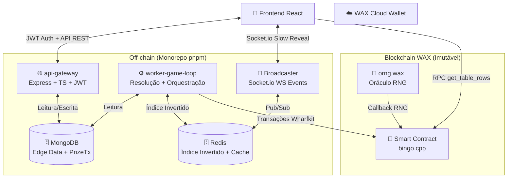
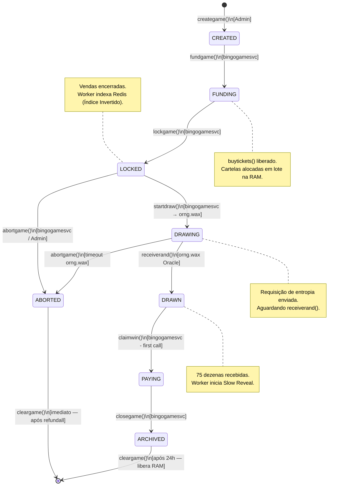
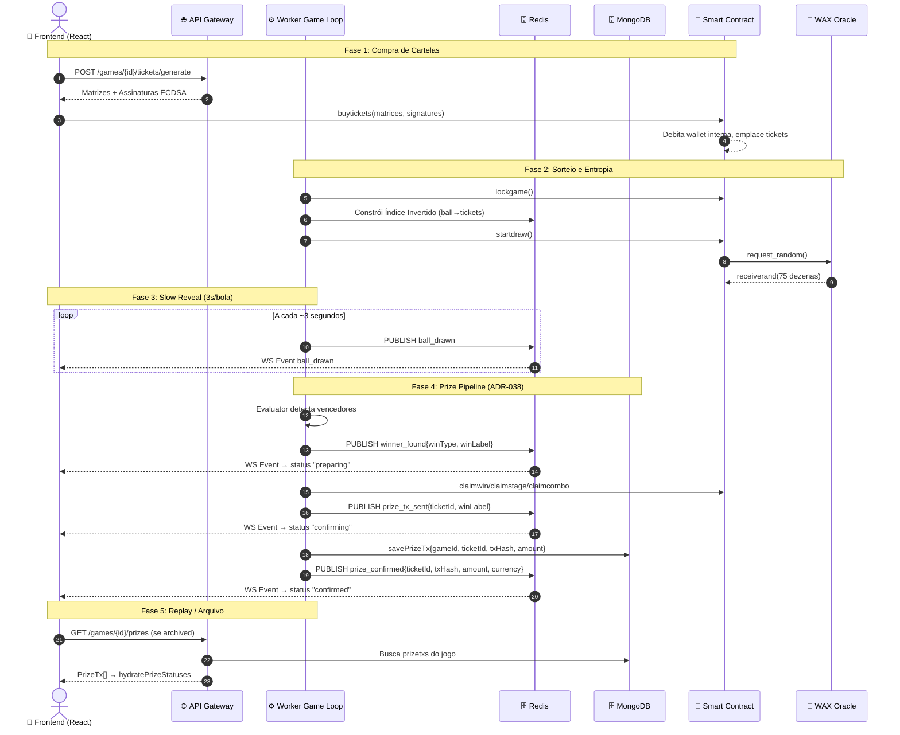

# Documentação de Arquitetura e Fluxos do Sistema

**Domínio:** Plataforma Descentralizada de Bingo GameFi
**Padrão de Diagramação:** Mermaid.js (Diagrams-as-Code)

Este documento centraliza a representação visual dos fluxos de dados, da infraestrutura e da máquina de estados do Smart Contract. Serve como mapa de navegação entre On-chain (Antelope/WAX) e Off-chain (Node.js/React monorepo).

---

## 1. Topologia Macro e Infraestrutura Híbrida (CQRS)

O sistema utiliza CQRS. Operações financeiras ocorrem on-chain (Command). Leitura, resolução algébrica e eventos em tempo real ocorrem off-chain (Query/Stream).



---

## 2. Máquina de Estados Finita (FSM) do Smart Contract

A FSM do contrato C++ é estritamente linear e bloqueante. Validações de estado impedem ações fora de ordem temporal.



---

## 3. Diagrama de Sequência: Jogo Completo + Prize Pipeline

Fluxo do início da partida ao painel de premiação com 3 estados de pagamento.



---

## 4. Arquitetura Off-Chain (Monorepo)

### 4.1. Serviços

| Serviço | Diretório | Stack | Responsabilidade |
|---------|-----------|-------|------------------|
| **Frontend** | `apps/frontend/` | React 19 + Vite + TS + Vitest | UI do jogador/admin/sponsor. Slow Reveal, GameRoom, ReplayRoom. i18n pt/en/zh. |
| **API Gateway** | `apps/api-gateway/` | Express 5 + TS + Jest | REST API: auth JWT, tickets, rooms, admin, prizes. MongoDB leitura. |
| **Worker Game Loop** | `apps/worker-game-loop/` | Node + Wharfkit + Jest | Orquestração FSM, evaluator bitmask, payouts, prize persistence, RabbitMQ consumer. Redis inverted index. |
| **Broadcaster** | `apps/worker-game-loop/` (mesmo processo) | Socket.io + Redis Pub/Sub | Eventos WS em tempo real (ball_drawn, winner_found, prize_tx_sent, prize_confirmed). |
| **Harness E2E** | `apps/harness/` | Jest + Wharfkit | Testes on-chain contra nodeos real + oracle daemon. |

### 4.2. Persistência e Mensageria

| Sistema | Uso |
|---------|-----|
| **Redis** | Índice Invertido (game→ball→tickets), Cache de queries, Pub/Sub do Broadcaster |
| **MongoDB** | Dados off-chain: profiles, rooms_metadata, chat_messages, gametypes_metadata, prizetxs (ADR-038), buyintxs, nfts_cache |
| **RabbitMQ** | Filas assíncronas para drops (dropWorker), notificações |

### 4.3. Prize Pipeline (ADR-038)

Cadeia de 3 eventos WS + persistência MongoDB + API REST:

```
winner_found ──────► Frontend: "preparing"
    ↓ (executa tx on-chain)
prize_tx_sent ──────► Frontend: "confirming"
    ↓ (savePrizeTx MongoDB)
prize_confirmed ────► Frontend: "confirmed"  {txHash, amount, currency}
```

**Collections MongoDB:**

`prizetxs` — índice único `{gameId, ticketId, winLabel}`. Idempotência garantida.
`buyintxs` — índice único `{gameId, ticketId}`.

**API pública:** `GET /api/v1/games/{gameId}/prizes` → `{items: PrizeTx[], total, gameId}`

**Frontend:** `hydratePrizeStatuses` injeta dados da API em jogos arquivados (`isStaticFinalState`). Chave composta `ticket_id:winLabel`. Nunca sobrescreve WS ativo.

### 4.4. Observabilidade (Prometheus + Grafana)

Métricas do worker em `infra/grafana/dashboards/worker-game-loop.json`:
- `prize_payments_total`, `prize_payments_amount_total`
- `prize_pipeline_duration` (prepare/send/confirm)
- `prize_persist_total` (success/duplicate/error)
- `buyin_persisted_total`, `prize_rtp_ratio`

---

## 5. Modelo de Entidades — MongoDB

### Coleção: `profiles`

```json
{
  "_id": "ObjectId",
  "wallet_address": "jogador1.wax",
  "nickname": "CryptoKing",
  "avatar_nft_asset_id": "1099511627776",
  "preferences": {
    "locale": "pt-BR",
    "sound_enabled": true
  },
  "progression": {
    "xp": 4500,
    "tier": "Gold",
    "games_played": 142
  }
}
```

### Coleção: `chat_messages`

Índice TTL 7 dias.

```json
{
  "_id": "ObjectId",
  "room_id": "12345",
  "wallet_address": "jogador1.wax",
  "message": "Bingo!!",
  "is_sponsor_drop": false,
  "timestamp": "ISODate"
}
```

### Coleção: `prizetxs` (ADR-038)

Índice único composto: `{ gameId, ticketId, winLabel }`.

```json
{
  "_id": "ObjectId",
  "game_id": "1780000000001",
  "ticket_id": "abc123def456",
  "win_type": "stage",
  "win_label": "stage_1",
  "account": "jogador1",
  "transaction_id": "abc123...",
  "amount": "125.0000",
  "currency": "WAX",
  "status": "confirmed"
}
```

### Coleção: `buyintxs` (ADR-038)

Índice único composto: `{ gameId, ticketId }`.

```json
{
  "_id": "ObjectId",
  "game_id": "1780000000001",
  "ticket_id": "abc123def456",
  "account": "jogador1",
  "amount": "10.0000",
  "currency": "WAX"
}
```

### Coleção: `rooms_metadata`

```json
{
  "_id": "12345",
  "name": "Sala Platinum",
  "description": "Sala VIP com prêmios maiores",
  "chat_enabled": true,
  "auto_start_delay_sec": 30,
  "drops": [],
  "cover_image_url": "https://..."
}
```

### Coleção: `gametypes_metadata`

```json
{
  "_id": "ObjectId",
  "gametype_id": "1",
  "combinations": [...],
  "rules": [...]
}
```

### Coleção: `nfts_cache`

```json
{
  "_id": "ObjectId",
  "wallet_address": "jogador1.wax",
  "assets": [{
    "asset_id": "1099511627776",
    "schema_name": "credit_packs",
    "name": "Whale Pack",
    "backed_tokens": "10000.0000 BINGO"
  }],
  "last_synced": "ISODate"
}
```

---

## 6. Referências

| Documento | Descrição |
|-----------|-----------|
| `CLAUDE.md` | Guia do projeto, comandos, git flow |
| `docs/adr/ADR-038-prize-pipeline.md` | Prize pipeline completo |
| `docs/adr/ADR-013-multi-match.md` | Multi-match + seções de cartela |
| `docs/adr/ADR-014-game-orchestration.md` | Orquestração FSM |
| `docs/asyncapi.yaml` | Eventos WS (prize_tx_sent, prize_confirmed) |
| `docs/openapi.yaml` | API REST (GET /games/:gameId/prizes) |
| `docs/SPEC.md` | Especificação mestre (§1.8 Prize Pipeline) |
