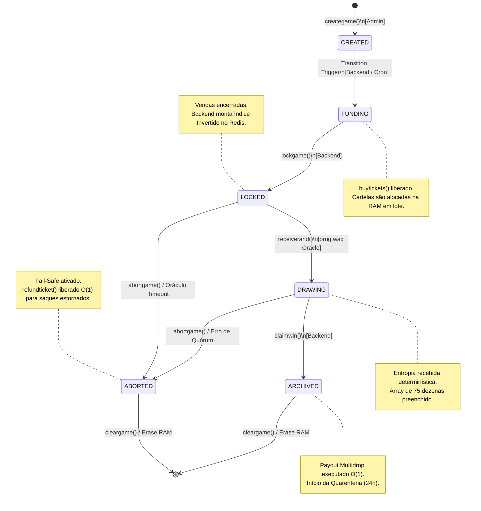
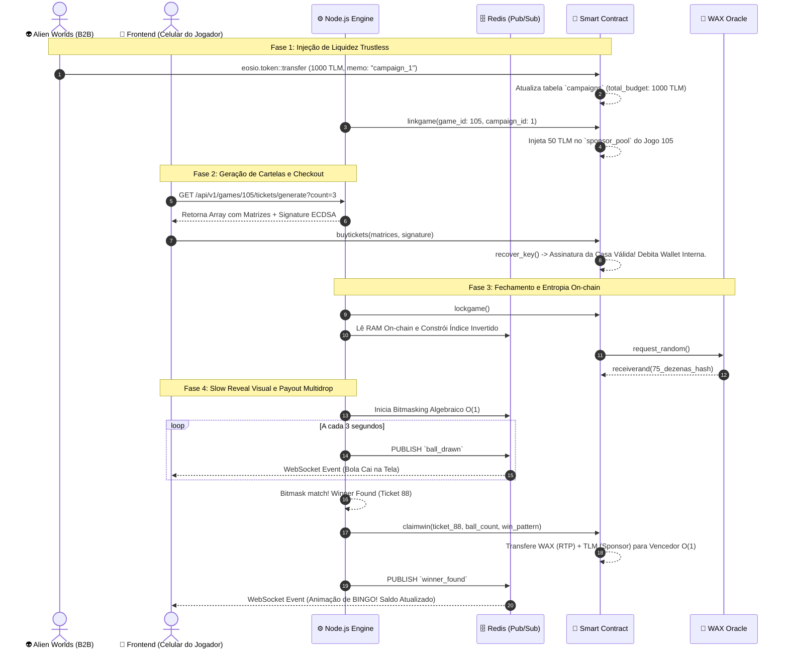

# Documentação de Arquitetura e Fluxos do Sistema

**Domínio:** Plataforma Descentralizada de Bingo GameFi
**Padrão de Diagramação:** Mermaid.js (Diagrams-as-Code)

Este documento centraliza a representação visual dos fluxos de dados, da infraestrutura de implantação e da máquina de estados do Smart Contract. Ele serve como mapa de navegação primário para novos desenvolvedores entenderem a fronteira entre On-chain (Antelope/WAX) e Off-chain (Node.js/React).

---

## 1. Topologia Macro e Infraestrutura Híbrida (CQRS)

O sistema utiliza o padrão Command Query Responsibility Segregation (CQRS). Operações de alta segurança e movimentação financeira ocorrem on-chain (Command), enquanto a leitura, resolução algébrica e transmissão de eventos em tempo real ocorrem off-chain (Query/Stream).

```mermaid
graph TD
    %% Atores e Clientes
    Player[📱 Celular do Jogador]
    CloudWallet[☁️ WAX Cloud Wallet]

    %% Camada de Backend (Kubernetes)
    subgraph "Cluster Kubernetes (Microsserviço Node.js)"
        Ingress[🌐 NGINX Ingress]
        Broadcaster[📡 Broadcaster Workers\n(WebSocket / Alto RAM)]
        Resolution[⚙️ Resolution Engine\n(Bitmasking / Alta CPU)]
        Redis[(🗄️ Cluster Redis\nÍndice Invertido & Pub/Sub)]
    end

    %% Camada Blockchain (Antelope/WAX)
    subgraph "Blockchain WAX (Imutável)"
        Contract[📜 Smart Contract\n(bingo.cpp)]
        Oracle[🎲 orng.wax\n(Oráculo de Entropia)]
        EosioToken[🪙 eosio.token\n(Contrato Base)]
    end

    %% Conexões Frontend
    Player <-->|1. Autenticação & Assinatura| CloudWallet
    Player <-->|2. Eventos Socket.io (Slow Reveal)| Ingress
    Player -->|3. RPC API (Checkout/Saques)| Contract
    
    %% Conexões Backend Internas
    Ingress <--> Broadcaster
    Broadcaster <-->|Subscribe| Redis
    Resolution <-->|Atualiza Índices/Bitmask| Redis

    %% Conexões Backend <-> Blockchain
    Resolution -->|4. Indexa State Stream| Contract
    Resolution -->|5. Assina claimwin() O_1| Contract
    Oracle -->|6. Callback RNG| Contract
    Contract <-->|7. Multidrop Payout| EosioToken

```

---

## 2. Máquina de Estados Finita (FSM) do Smart Contract

A FSM do contrato C++ é estritamente linear e bloqueante. Validações de estado (`eosio::check` ou `assert`) impedem que ações sejam chamadas fora de ordem temporal, protegendo a economia do DApp.



---

## 3. Diagrama de Sequência: Do Patrocínio ao "Winner Found"

Este fluxo detalha a linha do tempo (Timeline) que sustenta o motor de patrocínio B2B (Trustless Sponsorship) e o desacoplamento visual via WebSockets (Slow Reveal).



