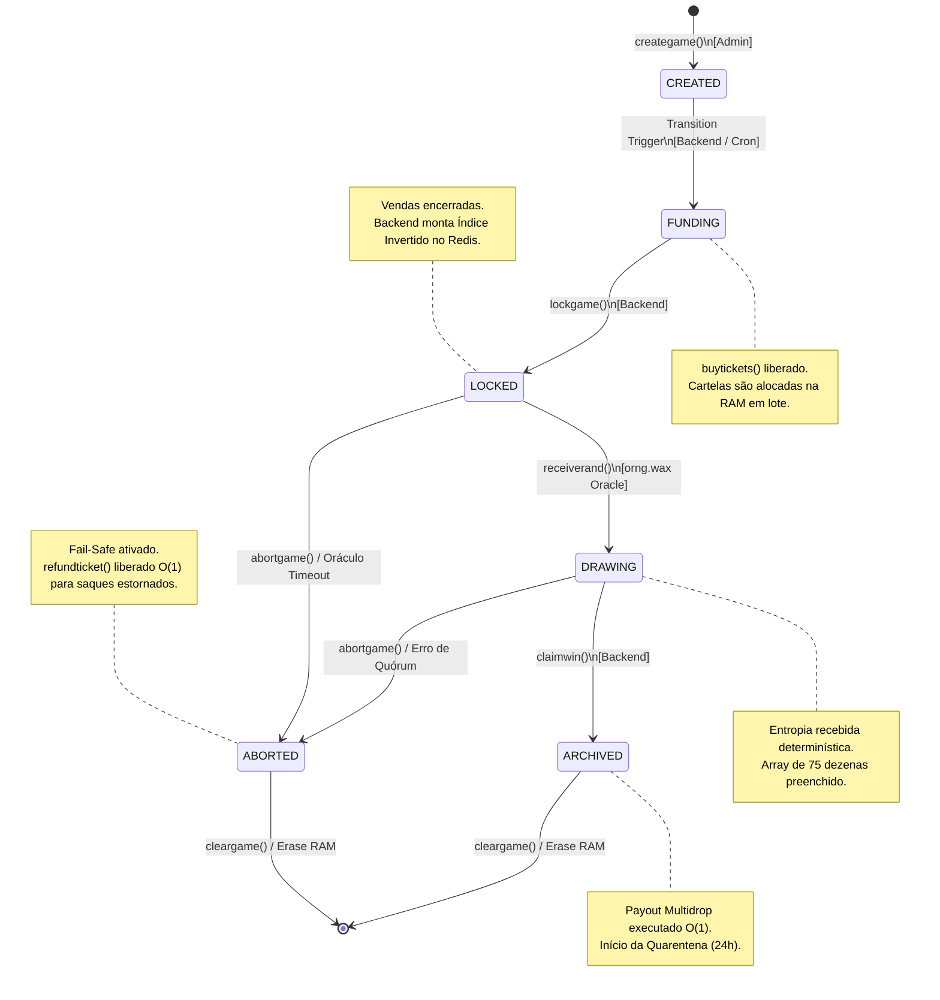
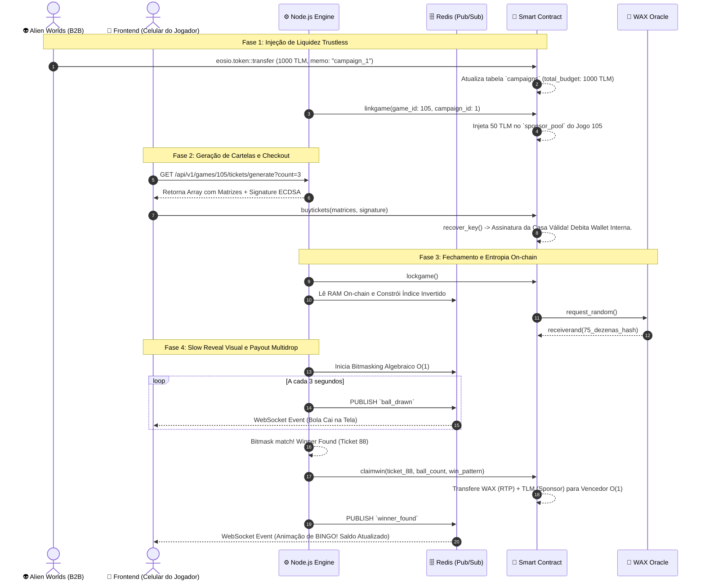

# Documentação de Arquitetura e Fluxos do Sistema

**Domínio:** Plataforma Descentralizada de Bingo GameFi
**Padrão de Diagramação:** Mermaid.js (Diagrams-as-Code)

Este documento centraliza a representação visual dos fluxos de dados, da infraestrutura de implantação e da máquina de estados do Smart Contract. Ele serve como mapa de navegação primário para novos desenvolvedores entenderem a fronteira entre On-chain (Antelope/WAX) e Off-chain (Node.js/React).

---

## 1. Topologia Macro e Infraestrutura Híbrida (CQRS)

O sistema utiliza o padrão Command Query Responsibility Segregation (CQRS). Operações de alta segurança e movimentação financeira ocorrem on-chain (Command), enquanto a leitura, resolução algébrica e transmissão de eventos em tempo real ocorrem off-chain (Query/Stream).

```mermaid
graph TD
    %% Atores e Clientes
    Player[📱 Celular do Jogador]
    CloudWallet[☁️ WAX Cloud Wallet]

    %% Camada de Backend (Kubernetes)
    subgraph "Cluster Kubernetes (Microsserviço Node.js)"
        Ingress[🌐 NGINX Ingress]
        Broadcaster[📡 Broadcaster Workers\n(WebSocket / Alto RAM)]
        Resolution[⚙️ Resolution Engine\n(Bitmasking / Alta CPU)]
        Redis[(🗄️ Cluster Redis\nÍndice Invertido & Pub/Sub)]
    end

    %% Camada Blockchain (Antelope/WAX)
    subgraph "Blockchain WAX (Imutável)"
        Contract[📜 Smart Contract\n(bingo.cpp)]
        Oracle[🎲 orng.wax\n(Oráculo de Entropia)]
        EosioToken[🪙 eosio.token\n(Contrato Base)]
    end

    %% Conexões Frontend
    Player <-->|1. Autenticação & Assinatura| CloudWallet
    Player <-->|2. Eventos Socket.io (Slow Reveal)| Ingress
    Player -->|3. RPC API (Checkout/Saques)| Contract
    
    %% Conexões Backend Internas
    Ingress <--> Broadcaster
    Broadcaster <-->|Subscribe| Redis
    Resolution <-->|Atualiza Índices/Bitmask| Redis

    %% Conexões Backend <-> Blockchain
    Resolution -->|4. Indexa State Stream| Contract
    Resolution -->|5. Assina claimwin() O_1| Contract
    Oracle -->|6. Callback RNG| Contract
    Contract <-->|7. Multidrop Payout| EosioToken

```

---

## 2. Máquina de Estados Finita (FSM) do Smart Contract

A FSM do contrato C++ é estritamente linear e bloqueante. Validações de estado (`eosio::check` ou `assert`) impedem que ações sejam chamadas fora de ordem temporal, protegendo a economia do DApp.



---

## 3. Diagrama de Sequência: Do Patrocínio ao "Winner Found"

Este fluxo detalha a linha do tempo (Timeline) que sustenta o motor de patrocínio B2B (Trustless Sponsorship) e o desacoplamento visual via WebSockets (Slow Reveal).



---

## 4. Arquitetura Off-Chain (Microsserviços)
A camada off-chain é projetada para escalar horizontalmente em clusters Kubernetes, utilizando containers Docker para garantir isolamento e resiliência. 

### 4.1. Topologia de Serviços
* **Game Loop Worker (Juiz Autônomo):** Serviço em Node.js responsável por monitorar o cronômetro das salas (Lobbies). Assina transações de `lockgame`, `startdraw` e `claimwin`. Falhas de rede são mitigadas por re-tentativas automáticas via fila.
* **Blockchain Indexer:** Consome os blocos da rede Antelope/WAX via WebSockets (State History Plugin). Grava eventos financeiros, compras de cartelas e vitórias no banco de dados relacional para consultas ultrarrápidas pelo frontend.
* **Community & Profile API:** Gerencia cadastros (off-chain), perfis, sistema de experiência (XP), guildas e Ligas Semanais.
* **Notification & Chat Service:** Serviço de WebSockets para bate-papo em tempo real e notificações push para o celular ou navegador do usuário (ex: alertas de "Near-Miss" / "Falta 1 número").

### 4.2. Persistência Poliglota e Mensageria
* **PostgreSQL (Core Ledger):** Banco de dados relacional (ACID). Armazena dados sensíveis, mapeamento de perfis, logs de auditoria e espelhamento do histórico financeiro on-chain para emissão de relatórios contábeis e conformidade com a Lei 14.790/2023.
* **MongoDB (Dynamic Edge):** Banco de dados NoSQL. Armazena histórico efêmero de chat, telemetria de cliques do usuário, configurações de skins de cartelas e logs de Lobbies ativos. Permite alta mutabilidade sem travar esquemas relacionais.
* **RabbitMQ (Message Broker):** Espinha dorsal da comunicação assíncrona. Desacopla o Game Loop do Indexer. Exemplo: Quando o tempo do lobby expira, uma mensagem `Trancar_Lobby_ID` entra na fila. O Worker consome e garante o processamento on-chain.

## 5. Tokenomics e Economia NFT (AtomicAssets)
O ecossistema financeiro é autossustentável, utilizando NFTs utilitárias e lastreadas.

### 5.1. Initial NFT Offering (INO) com Backed Tokens
* **O Ativo Base:** Emissão do token nativo `$BINGO` (CryptoBingo Token) via contrato `eosio.token` customizado.
* **Credit Packs:** Venda primária de NFTs (Starter, Pro, Whale) precificados em WAX. Todo o capital arrecadado vai para a *Treasury* (Multi-sig) da plataforma.
* **Lastro (Backed Tokens):** Cada NFT "Credit Pack" carrega nativamente um lastro de tokens `$BINGO` utilizando a mecânica *Backed Tokens* do protocolo AtomicAssets. O preço no mercado secundário (AtomicHub) nunca será inferior ao valor do token lastreado, protegendo investidores.
* **Burn Mechanism:** Para utilizar os créditos, o jogador realiza a ação de `burn` (queima) do NFT no frontend. O contrato AtomicAssets destrói a mídia e libera os tokens `$BINGO` líquidos para a carteira do usuário jogar.

### 5.2. Utilidade e Royalties B2B
* Todos os cosméticos (Avatares), VIP Passes e Cartelas Patrocinadas são cunhados como NFTs.
* **Creator Fee:** Uma taxa percentual (ex: 5%) é aplicada no mercado secundário. O contrato arrecada passivamente receita em cada negociação entre jogadores.
* **Airdrops e XP:** Rankings semanais e níveis de XP disparam airdrops automatizados de NFTs consumíveis (Boosters) e tokens como cashback.

---

## 6. Modelo de Entidades e Relacionamentos (MER) - Persistência Poliglota

Para suportar o alto volume de leitura/escrita do ecossistema e garantir total adequação às regulamentações de proteção de dados (LGPD) e normativas de apostas de quota fixa (Lei 14.790/2023), o armazenamento de dados é hibridizado.

### 6.1. PostgreSQL (Core Ledger & Compliance)
Responsável por dados imutáveis, histórico financeiro espelhado da blockchain e dados sensíveis pseudonimizados.

**Tabela: `users` (Identidade Base)**
* `id` (UUID, PK)
* `wallet_address` (VARCHAR, Unique, Index) - *Ex: jogador1.wax*
* `role` (ENUM: 'player', 'moderator', 'sponsor', 'admin')
* `kyc_status` (ENUM: 'none', 'pending', 'verified')
* `created_at` (TIMESTAMP)

**Tabela: `kyc_vault` (Cofre de Dados Sensíveis - LGPD)**
* `id` (UUID, PK)
* `user_id` (UUID, FK -> users.id, Unique)
* `encrypted_real_name` (VARCHAR)
* `encrypted_document` (VARCHAR) - *Criptografia em repouso (AES-256)*
* `country_code` (VARCHAR) - *Para controle de jurisdição*

**Tabela: `games_history` (Espelho do Smart Contract)**
* `game_id` (BIGINT, PK) - *Sincronizado com o on-chain*
* `status` (VARCHAR)
* `drawn_balls` (INT[])
* `total_prize_pool` (DECIMAL)
* `resolved_at` (TIMESTAMP)

**Tabela: `transactions_ledger` (Auditoria Financeira)**
* `tx_id` (VARCHAR, PK) - *Hash da transação on-chain*
* `user_id` (UUID, FK -> users.id)
* `game_id` (BIGINT, FK -> games_history.game_id)
* `action_type` (ENUM: 'deposit', 'withdraw', 'buy_ticket', 'claim_win')
* `amount` (DECIMAL)
* `currency` (VARCHAR) - *Ex: WAX, BINGO*
* `timestamp` (TIMESTAMP)

### 6.2. MongoDB (Dynamic Edge & Engagement)
Responsável pela camada social, internacionalização, gamificação e dados efêmeros que exigem leitura em milissegundos e esquemas dinâmicos.

**Coleção: `profiles` (Gamificação e Preferências)**
```json
{
  "_id": "ObjectId",
  "wallet_address": "jogador1.wax", // Chave de ligação com o Postgres
  "nickname": "CryptoKing",
  "avatar_nft_asset_id": "1099511627776",
  "preferences": {
    "locale": "zh-CN", // Motor de i18n (Suporte: en, pt, es, fr, ru, zh, ja)
    "currency_display": "USD",
    "sound_enabled": true
  },
  "progression": {
    "xp": 4500,
    "tier": "Gold",
    "games_played": 142
  }
}

```

**Coleção: `chat_messages` (Interação Efêmera)**

```json
{
  "_id": "ObjectId",
  "lobby_id": "game.slxs2",
  "wallet_address": "jogador1.wax",
  "message": "Bingo!!",
  "is_sponsor_drop": false,
  "timestamp": "ISODate"
}

```

*(Nota: Esta coleção terá um índice TTL (Time-To-Live) para apagar mensagens automaticamente após 7 dias, economizando custos de storage).*

**Coleção: `nfts_cache` (Espelho de Inventário do AtomicHub)**

```json
{
  "_id": "ObjectId",
  "wallet_address": "jogador1.wax",
  "assets": [
    {
      "asset_id": "1099511627776",
      "schema_name": "credit_packs",
      "name": "Whale Pack",
      "backed_tokens": "10000.0000 BINGO"
    }
  ],
  "last_synced": "ISODate"
}

```
